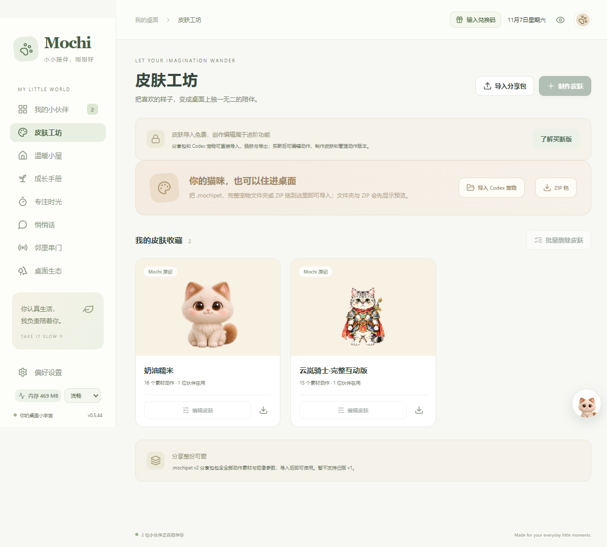
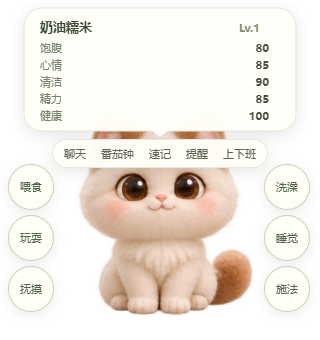

# Mochi 桌宠使用说明书

[飞书桌面版使用说明书](https://my.feishu.cn/wiki/IRawwwYdliuWQNkAQIxcgnnlnMb)

小小陪伴，刚刚好。

**适用版本：Mochi 桌面版 0.5.44。**

可在软件左下角查看版本号。动作环与拖入导入从 0.5.40 起提供，批量删除从 0.5.42 起提供。

## 1. 下载与安装

Mochi 桌面版用于 Windows，普通用户无需安装开发工具。

[在 GitHub 下载 Mochi 桌面版](https://github.com/ArminaCoding/mochi-desktop/releases/latest)

| 文件 | 适合谁 | 操作 |
| --- | --- | --- |
| Mochi-Setup-版本号.exe | 长期使用 | 运行安装向导，可选择安装目录。 |
| Mochi-Portable-版本号.exe | 试用、随身携带 | 放在固定文件夹后双击运行，无需安装。 |

同版本两个包的主要功能相同，选择其中一种即可。免安装版建议放进专用文件夹，保持程序位置稳定。升级前先备份数据，并从系统托盘退出正在运行的 Mochi；不要为了升级删除存档。

## 2. 第一次使用

1. 启动后按首次引导进入主界面。
2. 在「我的小伙伴」查看伙伴，使用眼睛按钮显示或隐藏，在伙伴设置里改名、换皮肤或调整大小。
3. 「皮肤工坊」管理已拥有的皮肤。当前新安装默认提供「奶油糯米」和「云岚骑士·完整互动版」。
4. 需要新增桌面伙伴时，选择「领养新伙伴」，再选择皮肤。

**皮肤是外观，伙伴是桌面上的角色。**导入皮肤不会自动增加一只桌宠；可以给现有伙伴换上它，也可以在名额允许时领养。

0.5.42 起，「我的小伙伴」和「皮肤工坊」都可以批量删除。可以逐个勾选，也可以全选后取消勾选要保留的项目。删除伙伴时，皮肤默认保留；需要一起清理时，可勾选同时删除不再被使用的自定义皮肤。内置皮肤和仍有伙伴使用的皮肤不能删除。删除皮肤会同时清理不再被引用的本机素材，不影响共用素材和已导出的分享包。

旧存档升级到 0.5.39 或更新版本时，会补齐缺少的默认皮肤，保留原伙伴、昵称和自定义皮肤，不自动增加已有存档的伙伴数量。

## 3. 桌宠基本操作

| 操作 | 效果 |
| --- | --- |
| 单击角色 | 打招呼。 |
| 短时间连续点击 | 可能触发生气等反馈。 |
| 按住后移动 | 拎起并拖动。 |
| 松开鼠标 | 放下；物理互动开启时可触发抛掷、掉落、弹跳。 |
| 鼠标停在角色上 | 显示状态卡与快捷入口。 |
| 右键角色 | 打开动作、开关、复位和管理菜单。 |
| Ctrl + Shift + H | 隐藏或显示全部桌宠；隐藏时收起管理中心。 |
| 双击系统托盘图标 | 打开管理中心。 |

透明区域通常允许点击后面的程序，角色本体和可见按钮接收操作。「安静陪伴」适合让伙伴待着，仍可手动互动；「物理互动」控制抛掷等行为；「置顶陪伴」决定角色是否浮在其他窗口上。

**关闭管理中心不会退出软件。**彻底退出请右键系统托盘图标，选择「退出 Mochi」。

找不到伙伴时，先确认眼睛按钮与全局隐藏状态，再使用伙伴复位、右键「回到屏幕中心」或托盘找回入口；关闭置顶后，角色也可能被其他窗口盖住。

## 4. 悬停动作环（0.5.40 起）

右键自己的桌宠，勾选「悬停动作环」；取消勾选即可关闭。也可在「偏好设置 → 常规 → 桌面与陪伴」操作同一开关。默认关闭，设置会保存。

开启后，把鼠标停在角色上稍等片刻，左右展开圆形按钮。移向圆球时菜单会保留，移出后延迟收起；拖动、按住或打开聊天等面板时收起。它替代底部照顾按钮栏，聊天和计时等入口继续保留。

图中的「施法」是自定义动作示例，不代表每套皮肤都自带。

每套皮肤可单独配置：

1. 皮肤工坊 → 找到皮肤 → 编辑皮肤。
2. 在「悬停动作环」里，为左右两侧最多六个按钮选择已有动作。
3. 保存后给伙伴使用这套皮肤；可留空不显示，也可恢复推荐。

喂食、玩耍、抚摸等按钮执行真实照顾互动，其他动作按钮播放所选动画。圆球不会自动生成新素材，皮肤需先拥有并启用对应动作。配置随皮肤保存、换肤和分享包传递。编辑配置属于皮肤创作功能，受买断权限影响；导入包已有的配置可随包使用。

## 5. 导入、制作和分享皮肤

### 导入分享包

打开皮肤工坊，点击「导入分享包」选择 .mochipet 文件。0.5.40 起也能直接从资源管理器拖入皮肤工坊。导入后，给现有伙伴换肤或领养新伙伴。

当前支持 Mochi v2 包。不完整包会提示缺少动作，可按提示兼容导入；兼容回退不代表皮肤已经拥有完整独立动作。重复导入相同名称、内容和配置的包不会反复创建相同皮肤。

### 导入文件夹或 ZIP

点击「导入 Codex 宠物」选择完整目录，或点击「ZIP 包」选择压缩文件。0.5.40 起两者也能拖入皮肤工坊，一次一个来源。

导入后先检查预览、名称、图集帧数与动作对应关系，再按提示生成皮肤。ZIP 无需手动解压。支持现有导入器识别的宠物结构，例如带主图集、元数据与扩展动作的 Codex / hatch-pet 包。任意图片文件夹或任意 ZIP 不会自动变成完整角色。七行图集可能需要填写每行帧数，部分标准图集可自动识别。

### 制作与编辑

1. 选择「制作皮肤」或编辑已有皮肤。
2. 选择动作，导入图片、GIF、视频、精灵图或序列帧。
3. 调整缩放、位置、速度和循环方式。
4. 对有纯色背景的素材，在「去背景与抠像」取色，调整容差、羽化和去绿边；透明素材无需重复抠像。
5. 预览并保存，再给伙伴换肤。

可以添加并分类自定义动作。独立视线图集与普通动作素材不同，不是所有皮肤都支持独立视线跟随。缺少动作时可能回退到已有素材；希望每次互动表现不同，需要补齐对应动作。

内置皮肤编辑后保存为私人副本，原内置皮肤保留。动作版本历史可查看、恢复之前的素材或参数。

素材限制：单个素材最多 32 MB，分享包素材合计最多 64 MB，序列帧最多 600 帧。GIF 会转换为序列帧；视频往返播放需先按界面提示抽帧。

### 分享给朋友

点击皮肤卡片的导出图标，生成 .mochipet。它包含引用的素材与配置，发这个文件即可。只分享角色用分享包；搬迁自己的全部伙伴和记录，需要备份完整数据。

## 6. 日常陪伴与工具

「我的小伙伴」管理伙伴，「温暖小屋」用于照顾、查看成长、日记和每日任务。喂食、玩耍、抚摸、洗澡、睡眠和照顾影响对应属性，变化会在状态卡范围内显示。

「专注时光」包含基础番茄钟及其他工具。基础计时支持预设、自定义、暂停和继续。买断后可使用完整工具箱，例如待办、看板、记事、提醒管理、多倒计时、纪念日、日历与独立工具浮窗。

桌宠快捷入口可打开聊天、番茄钟、速记、提醒和上下班计时。提醒卡片可完成或稍后提醒。上下班的工作日、时间与提醒选项在「偏好设置 → 互动与提醒」配置。软件完全退出期间不会持续运行桌面提醒。

「成长手册」提供成长阶段、陪伴摘要和习惯相关功能，按页面开关选择使用。

## 7. 配置聊天模型

Mochi 连接你配置的模型服务，安装软件不会自动提供云端模型额度。

1. 打开「偏好设置 → 聊天」。
2. 选择 Ollama 或兼容聊天接口。
3. 按服务说明填写地址、模型名和密钥；本地 Ollama 需先运行服务并准备模型。
4. 读取可用模型，保存配置，再到「悄悄话」或快捷聊天入口发送消息。

密钥通过 Windows 保护机制保存。不要将真实密钥放入公开截图、皮肤包或反馈。模型服务是否收费由所用服务决定。基础连接可用，更多聊天会话等能力见买断说明。

连接失败先检查服务、地址、模型名和密钥。页面显示的历史数量与发给模型的上下文条数是不同设置，调整显示历史不等于让模型读取全部历史。

## 8. 邻里串门

串门属于买断功能。双方电脑需能在同一局域网内通信，并运行支持串门的 Mochi。

1. 双方打开「邻里串门」并开启开关。
2. 选择要派出的伙伴，核对下方形象。
3. 点击「刷新附近」，或填写对方页面显示的 IP 和端口。
4. 发送邀请，等待对方同意。
5. 同步素材后，角色会出现在对方桌面；主人可召回，接待方可送客。

首次接收自定义角色需要同步素材，串门展示不会把主人的养成存档转交给对方。网络中断时应用会尝试结束串门并恢复角色。

发现不到邻居时，检查双方开关、网络互通、防火墙权限与路由器设备隔离。不同网络环境可能需要单独排查。

## 9. 桌面生态

在「桌面生态」可布置禁区、休息区，并选择窗口让路、标题栏栖息、任务栏休息等行为；进阶能力以页面授权提示为准。

编辑流程：编辑区域 → 选择类型 → 绘制或调整 → 保存 → 退出编辑层。

禁区让自由活动的伙伴避开重要工作位置，休息区安排歇脚处。窗口相关行为还需要对应开关及运行条件满足。角色一直停着时，先检查安静陪伴、睡眠、隐藏和区域设置。关闭生态总开关后仍可进行基本陪伴和互动。

## 10. 性能与偏好设置

管理中心左下角、内存读数旁的下拉框可快速切换，也可使用「偏好设置 → 常规 → 桌面与陪伴」。新存档默认流畅。

| 模式 | 常态渲染预算与特点 |
| --- | --- |
| 流畅 | 最高约 60 帧，偏向顺滑动画。 |
| 均衡 | 约 30 帧，兼顾动画和资源。 |
| 节能 | 约 15 帧，预览趋于静态、缓存更少，隐藏窗口更快休眠。 |
| 自动 | 使用电池时节能，接通电源时均衡。 |

实际帧率受电脑与素材影响，按住或拖动期间可能临时提高刷新率。切换会应用到正在运行的窗口，无需重启；内存下降可能需要等待素材释放和系统回收。

降低占用可先切节能，收回不用的伙伴，关闭不用的浮窗，减少同时播放的高分辨率动画。

偏好设置分为「常规」「互动与提醒」「聊天」「数据与更新」。软件图标可在常规设置中自行导入或恢复默认。

## 11. 免费与买断

以下适用于商业发行版，以软件中的权限提示为准。

| 免费 | 买断后扩展 |
| --- | --- |
| 最多两位本地伙伴 | 最多二十位伙伴 |
| 导入、换肤、导出分享包 | 制作皮肤、编辑动作与版本管理 |
| 基础生态与少量布置 | 更多布置、独立生态偏好等 |
| 基础设置、性能模式、番茄钟、基础提醒 | 完整工具箱与更多工具浮窗 |
| 自接模型的基础聊天 | 更多聊天会话等进阶能力 |
| 使用已有动作环配置 | 编辑各皮肤的动作环配置 |
| 本地陪伴 | 邻里串门 |

点击顶部兑换码入口，或到「偏好设置 → 常规 → 买断授权」，输入发行方提供的激活码。售后资料和可复制的本机设备 ID 位于激活码输入框上方，称呼、联系方式和订单号可选填。激活需要联网，新设备会立即检查授权名额。

0.5.44 起，自动联网验证只安排在激活后的第 30 天和第 60 天，每个时间点最多尝试一次。到期时没打开软件，下次启动会补做最近一次到期的验证。断网或服务暂时故障时保留现有授权，这次尝试不自动重试。已激活用户可以在「买断授权」手动联网验证，也能查看上次成功验证的时间。

设备名额已满时，可向售后提供订单号或旧设备 ID。解绑旧设备后，再在新设备上激活。请妥善保管完整激活码。

## 12. 备份与换电脑

在「偏好设置 → 数据与更新」打开数据文件夹是最可靠的位置入口。打包版通常使用程序附近的「Mochi数据」，不可写等情况下可能使用系统用户目录。

1. 使用软件备份功能，或先从托盘完全退出。
2. 保存整个数据文件夹，包括 assets 素材目录。
3. 另一台电脑安装同版或兼容新版。
4. 使用恢复入口，或在软件关闭时恢复完整数据，再启动。

不要只复制 state.json 而遗漏素材。聊天密钥受本机 Windows 保护，换电脑后可能需要重填；买断授权也要满足设备绑定规则。「重置设置」不等于删除全部伙伴和皮肤，排查问题前优先备份。

## 13. 常见问题

**只有一只，找不到骑士？**

核对版本。0.5.39 起会补齐默认皮肤，但不会自动增加已有伙伴数量。到皮肤工坊查看，再给现有伙伴换肤或领养骑士。

**动作环或拖入没有入口？**

确认版本至少为 0.5.40；动作环需右键开启，拖入应在皮肤工坊、一次一个来源。文件夹和 ZIP 需为支持的宠物结构。若 Windows 限制不同权限程序间拖放，尽量让 Mochi 与资源管理器以相同普通权限运行。

**为什么圆球不足六个？**

未配置或没有启用可播放素材的动作不会显示。检查当前皮肤的圆球配置和动作素材。

**导入后桌面没多出一只？**

导入的是皮肤库；请给已有伙伴换肤，或选择领养新伙伴。

**关闭主窗口还在运行？**

这是正常后台陪伴。退出使用系统托盘菜单的「退出 Mochi」。

**怎样反馈问题？**

反馈时附上软件版本、安装版/免安装版、Windows 环境、复现步骤、预期与实际结果及截图。公开前遮住激活码、模型密钥、订单资料和私人聊天。
